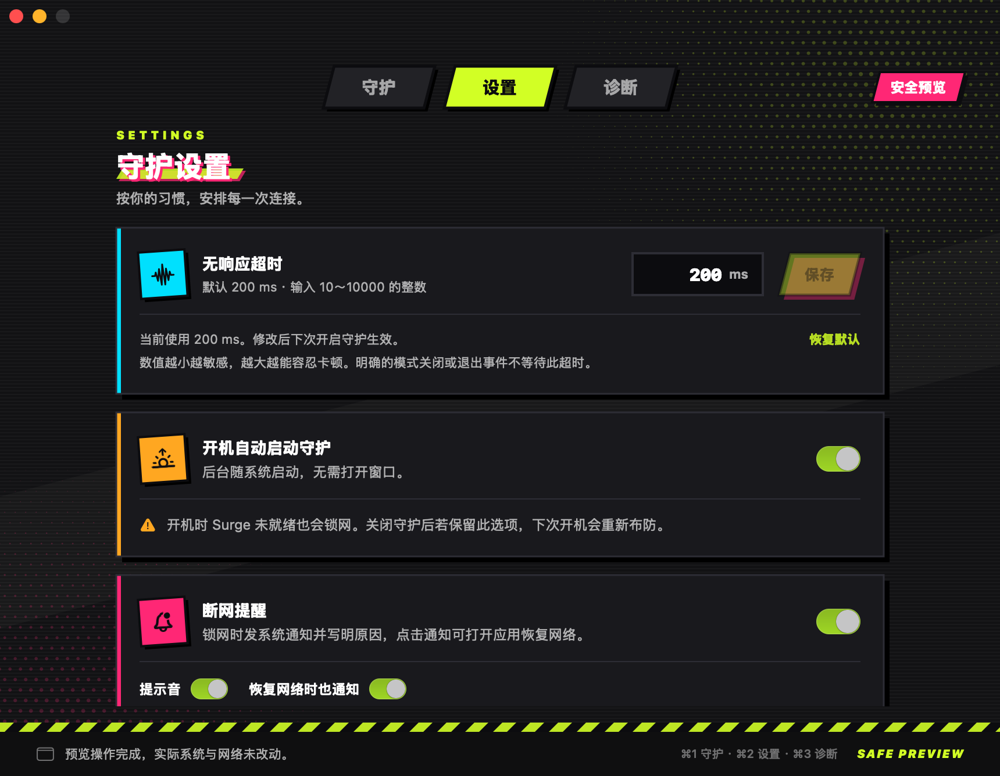
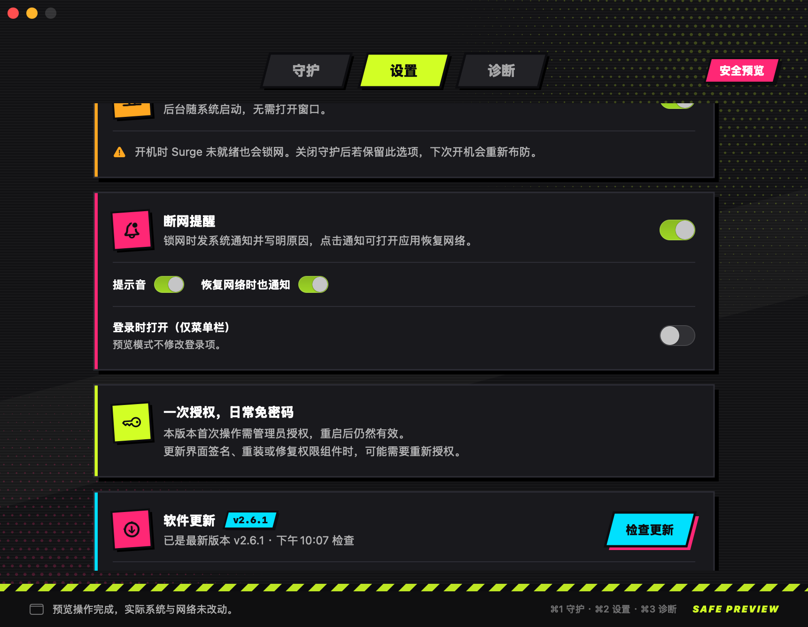
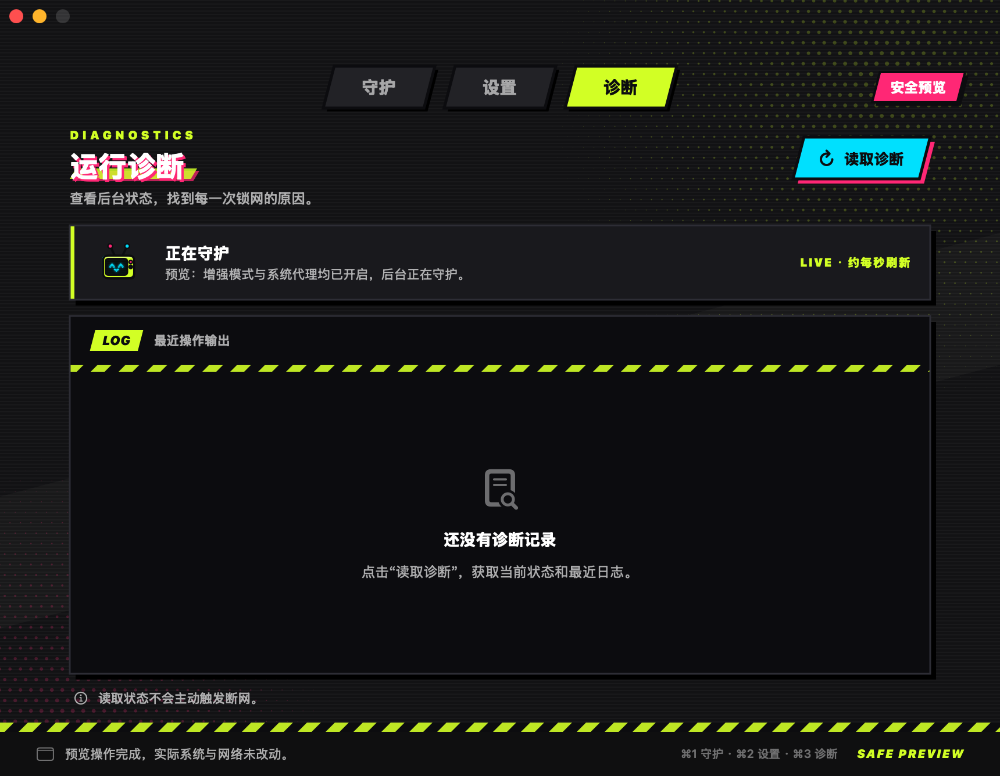
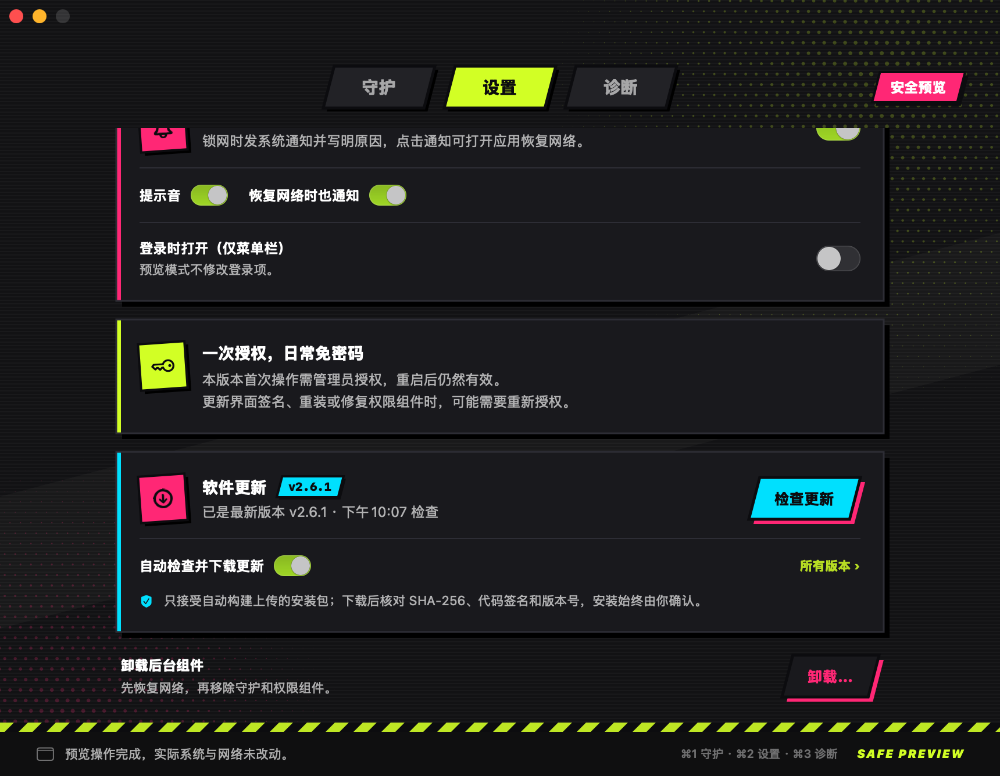

# Surge 断网守护

给 macOS 上的 Surge 用的“断网保险”。一旦 Surge 退出、增强模式或系统代理被关掉、或者 Surge 长时间没有响应，它会立刻切断本机网络，避免流量绕过代理直连出去；确认安全后，再由你手动恢复。

[⬇︎ 下载最新版 DMG](https://github.com/tod-zhang/surge-disconnect-guard/releases/latest) · [使用与恢复](docs/usage.md) · [验证范围](docs/validation.md)

<p align="center"></p>

> 适用于 **Apple Silicon + macOS 13 及以上**，只支持 **Surge**（需安装在 `/Applications/Surge.app`）。

## 它能做什么

| 触发情况 | 检测到并发出锁网的时间（设计值） |
| --- | --- |
| Surge 进程退出或崩溃 | 约 1 ms（直接监听进程退出事件） |
| 增强模式或系统代理被关闭 | 约 10 ms（持续查询 Surge 状态，每次间隔约 5 ms） |
| Surge 卡住、查询无响应 | 默认 200 ms 无响应即锁网，可在 10～10000 ms 之间调整 |
| 启动时无法确认 Surge 状态 | 首次连接最多等待 500 ms |

锁网后会**一直保持断网**，即使 Surge 重新打开也不会自动解除，必须由你在应用里点击“关闭并恢复网络”。这样可以避免在你不知情时网络悄悄恢复直连。

以上是按实现推算的检测耗时，不是实测的断网生效时间：网卡真正停止收发还要再加上系统执行关闭操作的时间。本工具是用户态程序，**不能保证零数据包泄漏**；它只依据 Surge 报告的模式状态判断，不会逐条检测连接或代理节点是否可用。

## 怎么断网

锁网时，后台引擎会先备份当前网络状态，然后同时：

- 把所有物理网卡（Wi-Fi、有线等）直接设为关闭（down）；
- 停用系统中的网络服务；
- 关闭 Wi-Fi 电源。

这里**没有使用 PF 防火墙规则**，局域网连接也会一起断开。恢复时按备份还原网络服务、网卡和 Wi-Fi 电源，原本就关着的服务不会被强行打开；VPN 可能需要手动重连。

## 界面与功能

<table>
  <tr>
    <td width="50%"><br><sub>守护已关闭</sub></td>
    <td width="50%"><br><sub>设置：无响应超时、开机守护</sub></td>
  </tr>
  <tr>
    <td width="50%"><br><sub>设置：断网提醒、一次授权、软件更新</sub></td>
    <td width="50%"><br><sub>诊断</sub></td>
  </tr>
</table>

<sub>截图来自 2.6.1 安全预览模式（`--preview`），不安装组件、不改动网络。</sub>

- **街头漫画风界面**：参考《绝区零》的街头漫画风格，分为守护、设置、诊断三页（⌘1～⌘3 切换）。守护状态由一个原创的复古电视头吉祥物表现，它会眨眼、晃天线、轻轻浮动：
  - 守护中：荧光黄绿，屏幕露出笑脸；
  - 已锁网：亮粉色，屏幕滚动警示条纹；
  - 状态待确认：琥珀色，屏幕带雪花噪点；
  - 已关闭：灰色，屏幕熄灭只留待机灯。
- **新图标**：电源键加警戒胶带的 App 图标；菜单栏图标按状态变色（守护中绿色、锁网橙色、待确认黄色、关闭暗色）。关闭窗口后仍保留在菜单栏。
- **断网提醒**（设置 → 断网提醒）：
  - 锁网时弹出系统通知并写明原因，可选提示音，点击通知直接打开应用恢复网络；
  - 恢复后可再推送一条“网络已恢复”；
  - 可开启“登录时打开（仅菜单栏）”，保证随时能收到提醒。提醒由界面发送，彻底退出界面后就不会再提醒（后台守护本身不受影响）。
- **应用内更新**（设置 → 软件更新，或菜单栏“检查更新…”）：默认开启自动检查（距上次检查超过 20 小时才会再查，约每天一次），发现新版后在后台下载，核对 SHA-256、代码签名、应用标识和版本号后，由你确认安装。如果守护正在运行，会先关闭守护并恢复网络，再替换应用并重新打开。
- **开机自动守护**（可选）：后台引擎随系统启动，不需要打开界面。注意开机启动**没有宽限期**，Surge 还没准备好也会锁网。
- **一次授权**：首次开启时输入一次管理员密码安装权限组件，之后同一版本的开启、关闭、保存设置、查看诊断都不再要密码。不保存密码、不修改 sudoers、不记录网络流量。
- **可调超时**：无响应超时默认 200 ms，可输入 10～10000 的整数毫秒。保存后在**下一次开启守护时生效**，当前这次继续用原值。

## 安装

1. 从 [Releases](https://github.com/tod-zhang/surge-disconnect-guard/releases/latest) 下载 `SurgeDisconnectGuard-vX.Y.Z.dmg`，把应用拖进“应用程序”。
2. 打开 Surge，**同时开启增强模式和系统代理**。
3. 打开本应用，点击“开启守护”，按提示完成一次管理员授权。
4. 状态显示“正在守护”即可。需要恢复网络时点击“关闭并恢复网络”。

应用使用本地 ad-hoc 签名，未经 Apple 公证。首次打开如被系统拦截，请在 Finder 中右键应用选择“打开”，或到“系统设置 → 隐私与安全性”中允许。

关闭窗口只是收起到菜单栏；在菜单栏菜单中选“退出界面（守护继续运行）”才会移除菜单栏图标，已开启的后台守护仍在运行。

## 升级

<p align="center"></p>

- **2.5.0 及以上**：直接用应用内更新即可，它会自动先恢复网络再替换应用。
- **从更早的版本升级，或手动替换应用**：
  1. 先在旧版里点击“**关闭并恢复网络**”；
  2. 退出旧版界面；
  3. 把新版拖进“应用程序”覆盖旧版；
  4. 打开新版，重新点击“开启守护”。

新版首次操作需要重新授权一次（权限组件随版本更新），之后同版本继续免密。

## 应急恢复与卸载

应用打不开时，可在终端执行：

```sh
sudo '/Library/Application Support/SurgeDisconnectGuard/sgctl' recover
```

这会恢复网络并暂停开机加载。请不要手动删除 `locked.json` 或 `armed.json` 来代替恢复。

卸载请在“设置”页底部点击“卸载”，它会先恢复网络再移除后台组件。直接把应用拖进废纸篓**不会**停止已安装的后台守护。更多细节见 [使用与恢复](docs/usage.md)。

## 从源码构建

需要 Apple Silicon Mac 和 Xcode Command Line Tools；测试脚本需要 Python 3（无第三方依赖）。

```sh
# 编译检测引擎并运行自检
./build.sh

# 隔离的控制流程测试，不执行真实特权操作
python3 test_controller.py
python3 gui/test_gui_control.py
python3 gui/test_permission_control.py

# 构建应用和 DMG（过程中会运行引擎、GUI、权限组件自检）
mkdir -p dist
./gui/build-dmg.sh "$PWD/.build/release" "$PWD/dist/SurgeDisconnectGuard-v2.6.1.dmg"
```

构建和自检不会安装后台，也不会改动网络。

## 自动构建与发布

GitHub Actions 在 macOS 上自动编译、自检并打包 DMG：

- 每个 PR 和推送都会跑构建与自检；
- 合并到 `main` 时，如果版本号是新的，CI 会自动创建 `vX.Y.Z` 标签和 Release，并上传 DMG（已发布过的版本只构建不发布）；
- 也可以手动推送 `v*` 标签，CI 会检查标签与代码中的版本号一致。

发布新版本时，同步修改 `gui/build-dmg.sh` 里的 `VERSION`、`BUILD_NUMBER`，以及 `gui/Updater.swift` 里的 `fallbackAppVersion`。

## 代码结构

| 文件 | 用途 |
| --- | --- |
| `SurgeGuard.swift` | 进程退出监听、持续模式查询、锁网、恢复及内存模拟自检 |
| `native.c` | 原生网卡控制、进程信息、受控子进程及退出事件接口 |
| `GuardSettings.swift` | 超时范围校验、配置持久化及共享自检 |
| `gui/GuardUI.swift` | SwiftUI / AppKit 界面、吉祥物、菜单栏及控制客户端 |
| `gui/Alerts.swift` | 锁网 / 恢复系统通知、登录时打开 |
| `gui/Updater.swift` | 检查 GitHub Releases、下载并校验 DMG、替换应用 |
| `gui/CreateIcon.swift` | 生成 App 图标与菜单栏图标 |
| `gui/ControlService.swift` | root 权限组件，核验用户身份、审计令牌及固定代码签名 |
| `gui/ControlIPC.swift` | 私有本地控制协议，只接受预设动作和经过校验的参数 |
| `gui/control-actions.sh` | root 目录中的固定控制操作 |
| `gui/build-dmg.sh` | 编译、自检、签名及 DMG 打包 |
| `.github/workflows/build-dmg.yml` | CI 构建、自检与自动发布 |

开发验证环境为 Apple Silicon、macOS 26.3、Surge 6.10.0。模式判断依赖 Surge 自带 CLI 的输出格式，Surge 改变格式时会按“无法确认”处理并锁网。
